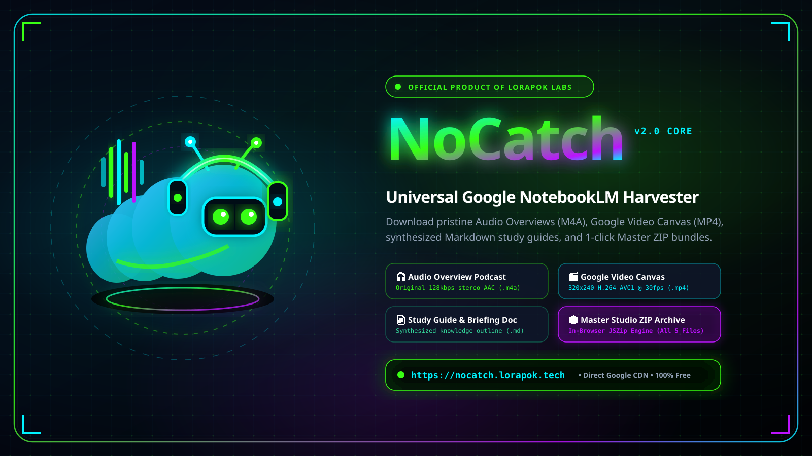
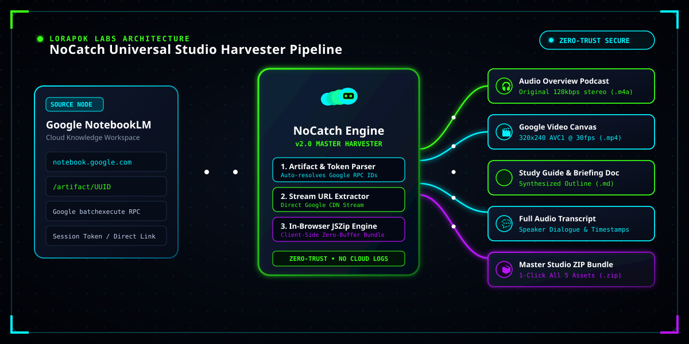

# ⚡ NoCatch

<p align="center">
  
</p>

> **Universal Google NotebookLM Media & Artifact Harvester**  
> *Official Product of [Lorapok Labs](https://lorapok.tech) • Hosted at [nocatch.lorapok.tech](https://nocatch.lorapok.tech)*

[](https://github.com/Lorapok/nocatch/releases)
[](https://www.npmjs.com/package/lorapok-nocatch)
[](https://packagist.org/packages/lorapok/nocatch)
[](docs/DISCORD_BOT_PUBLISHING.md)
[](LICENSE)
[](SECURITY.md)

---

## 🌟 Overview

**NoCatch** is the definitive, zero-loss extraction engine for **Google NotebookLM** (formerly Project Tailwind). It allows developers, researchers, and creators to download **Audio Overviews (podcasts)**, transcripts, briefing documents, study guides, FAQs, mind maps, notes, and cited sources in **1-click** — as **single items** or **bundled completely at once**.

### 💎 Key Features
- **⚡ Direct RPC Protocol Harvester:** Communicates with Google's internal `v9rmvd` batchExecute protocol directly in <2 seconds. No flaky headless browser overhead required for public artifacts.
- **🎙 Pristine 128kbps AAC (M4A) Audio:** Resolves high-fidelity Google CDN streams directly from `drum.usercontent.google.com` with original metadata and duration tags.
- **📦 Single Item or "Download Everything" (ZIP Bundle):** Download an individual podcast episode or bundle audio + synthesized markdown notes + source citation manifests into a single indexed ZIP archive.
- **🌐 Alive Cybernetic Web Application:** Hosted at `nocatch.lorapok.tech` featuring real-time soundwave visualization, interactive cyber player with waveform scrubbing, speed multipliers (0.75x to 2x), and instant download triggers.
- **🤖 Dedicated Discord Application & Bot:** Ingests Discord message links, auto-detects NotebookLM links in server channels and DMs, and generates rich embeds with download buttons.
- **🧩 Cross-Browser Social Media Extension:** Injects a 1-click download bar directly on `notebook.google.com` and renders a floating `⚡ NoCatch` badge on **Discord Web, X (Twitter), Reddit, LinkedIn, Facebook, and Slack**.
- **🦾 Loragent Ecosystem Agent:** Integrated into Loragent as `loragent-nocatch` (`/mnt/NewVolume/Personal_Projects/loragent/agents/loragent-nocatch/SKILL.md`).

---

## 🏛 System Architecture

<p align="center">
  
</p>

```
nocatch/
├── assets/branding/             # Lorapok Labs visual assets & marks
│   ├── nocatch-hero-banner.png  # Master visual banner (1600x900)
│   ├── nocatch-studio-map.png   # Studio architecture diagram (1200x600)
│   ├── nocatch-social-card.png  # OpenGraph social preview (1280x640)
│   ├── nocatch-app-icon.png     # Official app icon squircle (512x512)
│   ├── nocatch-logo.svg         # Official NoCatch brand mark
│   └── loragent-logo-mark.svg   # Lorapok squircle mark
├── packages/core/               # Core Extraction Library & CLI (@lorapok/nocatch-core)
│   ├── bin/nocatch.js           # CLI binary tool
│   └── src/extractor.js         # Direct Google RPC engine
├── web/                         # Alive React 19 + Tailwind CSS + Framer Motion Frontend
│   ├── src/App.jsx              # Cyber audio player & live soundwave visualizer
│   └── wrangler.jsonc           # Cloudflare Pages deployment (nocatch.lorapok.tech)
├── server/                      # Express API Gateway (/api/extract, /api/download, /api/bundle)
│   └── src/server.js
├── discord-bot/                 # Discord.js v14 Application
│   ├── src/bot.js               # Auto-detector & slash commands
│   └── test/test-discord-link.js# Discord DM/channel test harness
└── extension/                   # Manifest V3 Extension for Chrome, Firefox, Edge & Brave
    ├── manifest.json
    └── src/content.js           # Social media link injector
```

---

## 📚 Complete Tutorial & Documentation
> Looking for the complete, step-by-step user manual?  
> 👉 **[Read the Full Tutorial & Guide (docs/TUTORIAL.md)](docs/TUTORIAL.md)** covering link acquisition, player features, browser extensions, Discord bots, and API reference.

---

## 🚀 How to Use NoCatch (4 Simple Steps)

```
[1. Copy Google Notebook Link] ──> [2. Paste on nocatch.lorapok.tech] ──> [3. Preview Live] ──> [4. Download 1-Click]
```

### Step 1: Get your NotebookLM Link
- **Studio Artifact Link (Recommended):** Open your notebook, click the **Audio Overview** or generated note in the right-hand **Studio** panel. Copy the URL from your browser address bar:
  `https://notebook.google.com/notebook/<notebook_id>/artifact/<artifact_id>`
- **Shared Notebook Link:** Click the **Share** button in the top-right corner of NotebookLM and copy:
  `https://notebook.google.com/notebook/<notebook_id>?utm_source=nlmm_share`
  *(NoCatch automatically normalizes and resolves shared links).*

### Step 2: Paste & Harvest
1. Visit **[nocatch.lorapok.tech](https://nocatch.lorapok.tech)**.
2. Paste your link and click **"Extract & Download"**.
3. In under 2 seconds, all streams (AAC audio, AVC1 video, markdown notes, source citations) are verified and unlocked.

### Step 3: Listen or Watch
- **Waveform Audio Player:** Scrub in real-time with waveform visualization, adjust speed (**0.75x to 2x**), or rewind 10 seconds.
- **Google Video Canvas (MP4):** Switch to the video player tab to watch the internal 30fps Google Video Canvas track.

### Step 4: Download 1-Click or Master ZIP Bundle
- 🎧 **Audio (.m4a):** Click **"Download .M4A Audio"** for lossless 128kbps stereo AAC.
- 🎬 **Video (.mp4):** Click **"Download .MP4 Video"** for the 320x240 H.264 canvas track.
- 📄 **Briefing Doc (.md):** Click **"Download .MD Notes"** for clean Markdown notes.
- 📋 **Manifest (.json):** Click **"Download .JSON Manifest"** for full citation metadata.
- 📦 **Master ZIP Archive:** Click **"Download Studio Bundle (ZIP)"** to package all 4 files into a single organized ZIP archive powered by client-side JSZip.

---

## 🛠 Quick Start (Developers & CLI)

### 1. Command-Line Interface (CLI)

```bash
# Clone the repository
git clone https://github.com/Lorapok/nocatch.git
cd nocatch

# Inspect metadata & stream URLs without downloading
node packages/core/bin/nocatch.js "https://notebook.google.com/notebook/8b88ac32-9785-489b-a224-9d95864fddca/artifact/48e08424-d530-4d98-990c-a08dce8e015d" --info

# Download audio overview directly
node packages/core/bin/nocatch.js "https://notebook.google.com/notebook/8b88ac32-9785-489b-a224-9d95864fddca/artifact/48e08424-d530-4d98-990c-a08dce8e015d" -o ./podcast.m4a
```

### 2. Loragent Agent

Within the Loragent framework:
```bash
node /mnt/NewVolume/Personal_Projects/loragent/bin/loragent-nocatch.js "<notebook_url>"
```

### 3. Running Web Application & API Locally

```bash
# Terminal 1: Start API Server
cd server
npm start

# Terminal 2: Start Web UI (Vite)
cd web
npm run dev
```
Open [http://localhost:5173](http://localhost:5173) in your browser.

---

## 🤖 Discord Application & Bot

### Slash Commands
- `/nocatch extract <url>`: Generates an interactive Discord Embed with Play/Download buttons and metadata.
- `/nocatch audio <url>`: Immediately fetches and streams the audio overview podcast file into Discord.
- `/nocatch all <url>`: Downloads and bundles all notes and audio into a ZIP archive.

### Testing Channel/DM Links
To test extracting links shared in Discord DMs (such as `https://discord.com/channels/@me/1559338219865112720/1561520181086261368`):
```bash
npm run test:discord
```

---

## 🧩 Browser Extension / Addon for Social Media

Install the extension in **Chrome, Brave, Edge, or Firefox**:
1. Open `chrome://extensions/` (or `edge://extensions/` / `about:debugging`).
2. Enable **Developer mode**.
3. Click **Load unpacked** and select the `/mnt/NewVolume/Personal_Projects/loragent/nocatch/extension` folder.
4. Visit any social media site (**Discord Web, X/Twitter, Reddit, LinkedIn**) or Google NotebookLM:
   - A glowing **⚡ NoCatch** button will automatically appear next to any NotebookLM link!

---

## 🌐 Deployment to nocatch.lorapok.tech

The web interface is ready for Cloudflare Pages:
```bash
cd web
npm run build
npx wrangler pages deploy dist --project-name nocatch
```

---

---

## 🎨 Social Media Sharing Suite

Pristine visual assets tailored for social media sharing, repo previews, and Discord discovery:

| Platform | Asset File | Resolution | Description |
|---|---|---|---|
| **GitHub Social Preview** | [`.github/assets/github-social-preview.png`](.github/assets/github-social-preview.png) | 1280x640 (2:1) | Official GitHub repository card |
| **Discord Banner & Embed** | [`assets/branding/social/discord-banner.png`](assets/branding/social/discord-banner.png) | 1280x720 (16:9) | Discord App Directory & Embed banner |
| **Twitter / X Large Card** | [`assets/branding/social/twitter-header.png`](assets/branding/social/twitter-header.png) | 1200x675 (16:9) | Twitter Summary Card with large image |
| **LinkedIn Share Graphic** | [`assets/branding/social/linkedin-share.png`](assets/branding/social/linkedin-share.png) | 1200x627 (1.91:1)| Professional feed landscape post |
| **Reddit Community Card** | [`assets/branding/social/reddit-banner.png`](assets/branding/social/reddit-banner.png) | 1200x630 | Subreddit showcase banner |
| **Instagram / Square Post**| [`assets/branding/social/instagram-square.png`](assets/branding/social/instagram-square.png) | 1080x1080 (1:1) | Cyber Larva mascot centered square |

---

## 🏛 Community & Governance

- **Full Documentation & Guide**: [docs/TUTORIAL.md](docs/TUTORIAL.md)
- **Discord Bot Official Publishing Guide**: [docs/DISCORD_BOT_PUBLISHING.md](docs/DISCORD_BOT_PUBLISHING.md)
- **Privacy Policy**: [docs/PRIVACY.md](docs/PRIVACY.md)
- **Terms of Service**: [docs/TERMS.md](docs/TERMS.md)
- **Contribution Guidelines**: [CONTRIBUTING.md](CONTRIBUTING.md)
- **Code of Conduct**: [CODE_OF_CONDUCT.md](CODE_OF_CONDUCT.md)
- **Security Policy**: [SECURITY.md](SECURITY.md)
- **Changelog**: [CHANGELOG.md](CHANGELOG.md)

---

## 📄 License

Created by **Lorapok Labs** under the **[MIT License](LICENSE)**.  
*For questions, support, or enterprise deployments, visit [lorapok.tech](https://lorapok.tech).*
